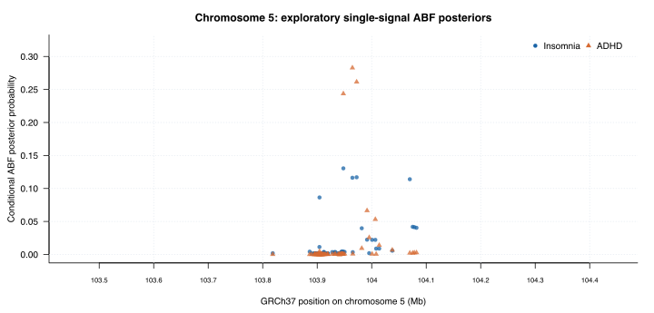

# Brain6 × AlphaGenome: chromosome 5 case study

**This report presents the original GWAS-based baseline.** See [frontal-cortex predictions](../jbrowse_predictions/FRONTAL_CORTEX_REPORT.md) and [AVI results](avi_mirror/AVI_PILOT_REPORT.md) for subsequent AlphaGenome analyses.

The frozen candidate is insomnia–ADHD, chr5:103,447,968–104,447,968 (GRCh37, one-based). Its 71 variant rows are the union of the separately reported exploratory 95% ABF credible sets; 71 passed the reference and coordinate checks. The eight ADHD credible-set members are included within that union. These are not independently confirmed causal variants.

The existing single-signal trait–trait coloc posterior PP.H4 is 0.9911 at p12=10⁻⁵ and 0.9174 at p12=10⁻⁶. These are model- and prior-dependent values, not evidence of a demonstrated mechanism. Brain6's LAVA family failed its QC gate; the alternative local analysis did not support this candidate at the frozen FWER threshold; no compatible independent two-trait locus replication was established.

The plot shows model-conditional PIPs only for the union of published credible sets. Points outside this selected union are not shown. Larger values indicate more posterior mass under the single-causal-variant ABF model; they are not measured functional effects.

| SNP | GRCh38 variant | Insomnia PIP | ADHD PIP | Credible-set membership |
|---|---|---:|---:|---|
| rs77960 | [chr5:104628884:G>A](https://deepmind.google.com/science/alphagenome/atlas?q=chr5%3A104628884%3AG%3EA&m=variant) | 0.1162 | 0.2828 | insomnia, adhd |
| rs30266 | [chr5:104636656:G>A](https://deepmind.google.com/science/alphagenome/atlas?q=chr5%3A104636656%3AG%3EA&m=variant) | 0.1170 | 0.2614 | insomnia, adhd |
| rs2431108 | [chr5:104612267:T>C](https://deepmind.google.com/science/alphagenome/atlas?q=chr5%3A104612267%3AT%3EC&m=variant) | 0.1305 | 0.2436 | insomnia, adhd |
| rs161645 | [chr5:104734216:A>G](https://deepmind.google.com/science/alphagenome/atlas?q=chr5%3A104734216%3AA%3EG&m=variant) | 0.1140 | 0.0022 | insomnia |
| rs12658032 | [chr5:104568525:A>G](https://deepmind.google.com/science/alphagenome/atlas?q=chr5%3A104568525%3AA%3EG&m=variant) | 0.0864 | 0.0046 | insomnia |
| rs416223 | [chr5:104655775:C>A](https://deepmind.google.com/science/alphagenome/atlas?q=chr5%3A104655775%3AC%3EA&m=variant) | 0.0224 | 0.0665 | insomnia, adhd |
| rs325500 | [chr5:104670966:A>G](https://deepmind.google.com/science/alphagenome/atlas?q=chr5%3A104670966%3AA%3EG&m=variant) | 0.0221 | 0.0532 | insomnia, adhd |
| rs6421926 | [chr5:104739429:T>C](https://deepmind.google.com/science/alphagenome/atlas?q=chr5%3A104739429%3AT%3EC&m=variant) | 0.0419 | 0.0022 | insomnia |

The displayed rows are ordered by the larger of the two conditional PIPs solely to make this case study readable. It is not a shared-causality score. Alleles in the GWAS beta columns refer to the source A1; the mapped GRCh38 REF/ALT is a separate orientation.

This baseline table does not use AlphaGenome output or assert a gene, tissue or mechanism. The later pilot scored all selected variants with overall AVI and obtained tissue predictions for one variant per region. All remaining five regions appear in `regions.tsv` and `variant_evidence.tsv`.
