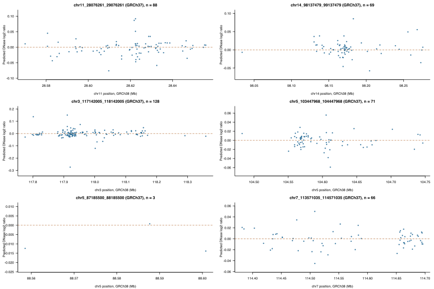

# Expanded frontal-cortex AlphaGenome analysis

**Status: 425 of 425 variants have complete extracted track windows.**

The same four frontal-cortex tracks, 1,048,576-bp input and 2,001-bp extracted window are used for every completed variant. The adult DNase and adult GTEx RNA columns in the evidence table are log₂((alternate 501-bp signal sum + 1)/(reference signal sum + 1)). RNA numbers are local-window summaries, not gene-level expression scores. Two embryonic strand-specific RNA summaries are also retained. These predictions are not measured effects, hypothesis-test p-values, causal-gene assignments, or proof of insomnia–ADHD interactions.

| Candidate region | Predicted | Total | Status |
|---|---:|---:|---|
| placo_insomnia__adhd_chr11_28076261_29076261 | 88 | 88 | COMPLETE |
| placo_insomnia__adhd_chr14_98137479_99137479 | 69 | 69 | COMPLETE |
| placo_insomnia__adhd_chr3_117142005_118142005 | 128 | 128 | COMPLETE |
| placo_insomnia__adhd_chr5_103447968_104447968 | 71 | 71 | COMPLETE |
| placo_insomnia__adhd_chr5_87185500_88185500 | 3 | 3 | COMPLETE |
| placo_insomnia__adhd_chr7_113571035_114571035 | 66 | 66 | COMPLETE |

Each dot is a variant; its vertical value is the predicted alternate-versus-reference DNase ratio in a 501 bp window. Panels use their own vertical scales. The chromosome and coordinate range in each title use GRCh37 candidate IDs; plotted positions use GRCh38.

## Exploratory largest local DNase changes

Within each currently completed subset, the row below has the largest absolute predicted adult DNase log₂ ratio. The sign compares the GRCh38 alternate allele with the reference allele; it is not a direction of sleep or disease risk. These are descriptive extremes among variants already extracted, not calibrated significance tests; when a region is incomplete its maximum can change. They do not establish causal variants or trait effects.

| Candidate region | Variant | Signed local DNase log₂ ratio | AVI PHRED interval | Coverage |
|---|---|---:|---:|---|
| placo_insomnia__adhd_chr11_28076261_29076261 | [rs10835373](https://deepmind.google.com/science/alphagenome/atlas?q=chr11%3A28622395%3AT%3EC&m=variant) | +0.091707 | 5.326 | 88/88 |
| placo_insomnia__adhd_chr14_98137479_99137479 | [rs79470265](https://deepmind.google.com/science/alphagenome/atlas?q=chr14%3A98182792%3AA%3EC&m=variant) | +0.085314 | 9.049 | 69/69 |
| placo_insomnia__adhd_chr3_117142005_118142005 | [rs62264764](https://deepmind.google.com/science/alphagenome/atlas?q=chr3%3A117920728%3AG%3EA&m=variant) | -0.273386 | 20.486 | 128/128 |
| placo_insomnia__adhd_chr5_103447968_104447968 | [rs2447828](https://deepmind.google.com/science/alphagenome/atlas?q=chr5%3A104611504%3AC%3ET&m=variant) | -0.058984 | 0.349 | 71/71 |
| placo_insomnia__adhd_chr5_87185500_88185500 | [rs324886](https://deepmind.google.com/science/alphagenome/atlas?q=chr5%3A88600784%3AC%3ET&m=variant) | -0.013850 | 0.271 | 3/3 |
| placo_insomnia__adhd_chr7_113571035_114571035 | [rs2189015](https://deepmind.google.com/science/alphagenome/atlas?q=chr7%3A114508188%3AA%3EG&m=variant) | +0.049892 | 7.121 | 66/66 |

The output table joins predictions to the frozen GWAS/AVI evidence without changing Brain6 evidence classes. The preparation-status column records the earlier pre-API-key snapshot; `tissue_prediction_status` is the current result. Each per-variant gzip file contains the 2,001-bp reference and alternate signal vectors; metadata and source byte-range hashes are retained in its companion provenance file. Model release was not exposed by the proxy. The public service is used for non-commercial research and its outputs are not used to train other ML models.
