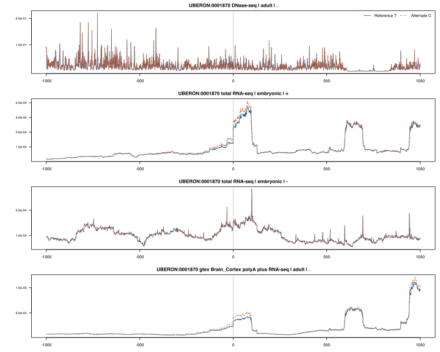

# Brain6 × AlphaGenome: frontal-cortex prediction pilot

**Scope:** one variant per insomnia–ADHD region, selected by the highest raw AVI score in the previously selected credible-set union. The public JBrowse service generated AlphaGenome reference and alternate sequence predictions for six variants with 1,048,576 bp sequence context. These are predictions rather than observed tissue measurements. Other variants and tissues were not predicted in this initial run. A subsequent [expanded analysis](../jbrowse_expanded/EXPANDED_REPORT.md) covers all 425 selected variants in the same tracks.

## Chromosome 5: rs2431108

At GRCh38 chr5:104612267:T>C, the adult frontal-cortex ENCODE DNase track has a predicted sum of 9.37010 for T and 9.37392 for C in the 501 bp window centered on the variant. The local log₂ ratio, with a pseudocount of one, is +0.000531. This near-zero value is a numerical result for this track and window; without a calibrated null, it is not evidence that the variant has no effect.

The service also returned an adult GTEx Brain_Cortex RNA track and two strand-specific embryonic ENCODE RNA tracks. The window-level values in the table below summarize local predicted signal only. They are **not gene-expression effect scores**: no gene exon mask, transcript attribution or calibrated per-gene variant score was calculated.

The horizontal axes show base-pair offset from rs2431108; the vertical axes show predicted signal on separate scales for each track. Blue is reference T and orange is alternate C.

## Six-region comparison

| Candidate variant | GRCh38 variant | AVI PHRED range | Adult DNase log₂ ratio | Adult GTEx RNA local log₂ ratio |
|---|---|---:|---:|---:|
| [rs2431108](https://deepmind.google.com/science/alphagenome/atlas?q=chr5%3A104612267%3AT%3EC&m=variant) | chr5:104612267:T>C | 19.999 | +0.000531 | +0.017345 |
| [rs4923550](https://deepmind.google.com/science/alphagenome/atlas?q=chr11%3A28615816%3AT%3EC&m=variant) | chr11:28615816:T>C | 14.661 | -0.028052 | +0.000936 |
| [rs76247422](https://deepmind.google.com/science/alphagenome/atlas?q=chr14%3A98162916%3AC%3ET&m=variant) | chr14:98162916:C>T | 17.978 | -0.015660 | +0.037783 |
| [rs62264764](https://deepmind.google.com/science/alphagenome/atlas?q=chr3%3A117920728%3AG%3EA&m=variant) | chr3:117920728:G>A | 20.486 | -0.273386 | -0.005143 |
| [rs4916723](https://deepmind.google.com/science/alphagenome/atlas?q=chr5%3A88558577%3AA%3EC&m=variant) | chr5:88558577:A>C | 15.992 | -0.012415 | -0.029034 |
| [rs1456021](https://deepmind.google.com/science/alphagenome/atlas?q=chr7%3A114688105%3AT%3EG&m=variant) | chr7:114688105:T>G | 17.163 | +0.004565 | +0.015974 |

For each track, the summary is log₂((sum alternate signal + 1)/(sum reference signal + 1)) over the 501 bp centered on the variant. The DNase calculation follows the local 501 bp sum-ratio form described for AlphaGenome accessibility scorers; it is calculated here from JBrowse prediction arrays, not returned by the official variant-scoring endpoint. The RNA ratio is a descriptive local window summary, not the model’s recommended gene-level RNA scorer. Both ratios are model predictions, not statistical tests. They are not calibrated to indicate significance or whether a variant mediates an insomnia–ADHD relationship.

The chr3 rs62264764 adult DNase ratio is more negative than the other five in this *selected* set. This is a candidate hypothesis for further assessment, not evidence of a causal variant, a target gene, or tissue specificity. Selecting one high-AVI SNP per region does not establish that it is the best causal candidate, and this table should not be generalized to all 425 variants.

The existing measured eQTL context is reported separately in `../avi_mirror/MOLECULAR_CONTEXT.md`; it must not be interpreted as validation of these predictions. Brain6’s failed primary LAVA family, model-conditional ABF colocalization and absence of independent two-trait locus replication are unchanged.

## Provenance and limits

All requests used the frontal-cortex ontology `UBERON:0001870` and the same DNase/RNA output types. The service reported track-specific assay, tissue, life stage and source metadata in each prediction receipt. For every variant, `track_window.tsv` contains reference and alternate predictions at 2,001 bases around the variant, and `track_summary.tsv` contains four track summaries; files and extracted HTTP byte ranges are hashed in each local `provenance.json`. The service did not expose a model release identifier. A future run could therefore differ.

The 1 Mb model context and GRCh38 reference/alternate alleles were verified against the request and prepared variant table. The proxy holds its own API key and is limited to non-commercial use. Inference outputs must not be used for clinical decision-making or to train another ML model. Signed URLs returned by the proxy are temporary and are not included in these artifacts.

[AlphaGenome model paper](https://www.nature.com/articles/s41586-025-10014-0) · [JBrowse AlphaGenome documentation](https://www.jbrowse.org/jb2/docs/tutorials/alphagenome/) · [AlphaGenome variant scoring documentation](https://github.com/google-deepmind/alphagenome/blob/main/docs/source/variant_scoring.md)
