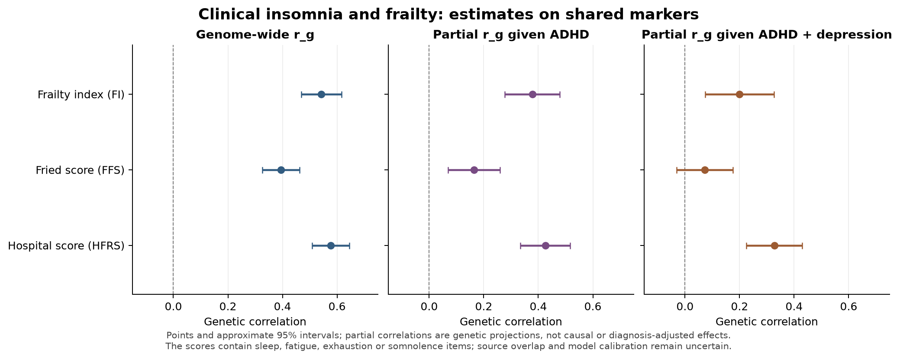

# Genetic relationships among insomnia, ADHD and frailty: a multi-source and functional-genomics research draft

**Status:** working manuscript, not a validated discovery report. Analyses are exploratory and several use overlapping or reused data. The [research report](RESEARCH_REPORT.md) and linked receipts provide fuller provenance. No claim is made that this is a systematic review or the first study of these relationships.

## Abstract

**Background.** Insomnia, neuropsychiatric conditions and frailty share genetic associations, but frailty instruments differ in the symptoms they include. In particular, the frailty index (FI) analyzed here includes sleep and tiredness, the Fried frailty score (FFS) includes exhaustion, and the hospital frailty risk score (HFRS) includes a somnolence-related diagnosis category. These overlaps complicate interpretation of sleep–frailty genetics.

**Methods.** We revisited summary-statistic genetic correlations across three frailty measures and multiple insomnia sources, and assessed individual physical measures, an objective physical-function composite and a post-hoc equal-weight index of standardized physical genetic components. We calculated partial genetic correlations given ADHD and depression and propagated paired block-jackknife uncertainty. We joined selected candidates to published reporter measurements and AlphaGenome predictions, and evaluated a small trait-correlation machine-learning prototype against baselines.

**Results.** On 991,707 shared markers, clinical-insomnia genetic correlations were 0.543 with FI, 0.395 with FFS and 0.577 with HFRS. After projecting out ADHD and depression genetic components, the respective partial correlations were 0.200 (SE 0.064), 0.073 (0.052) and 0.328 (0.052). A separate objective physical-function composite correlated with clinical insomnia at −0.090 (0.027). On a distinct 1,053,614-marker support, the explicit physical genetic index correlated at −0.0736 (0.0350) with registry insomnia and −0.2309 (0.0260) with questionnaire insomnia; the registry result did not meet a two-source correction. Associations changed with index weighting, while an alternative latent-factor association required unverified residual-covariance restrictions. A chromosome 5 colocalization sensitivity was prior-sensitive. The bounded ridge prototype showed limited source transfer, and reporter and sequence-model evidence did not establish a causal gene or mechanism.

**Conclusions.** Different frailty measures show different sleep-related genetic associations, with interpretation limited by symptom overlap, source dependence and LDSC diagnostics. A matched, sleep- and exhaustion-excluded frailty GWAS and independent validation are needed to address the central physical-frailty question.

## Introduction

Large GWAS have established a polygenic basis for insomnia and ADHD ([Jansen et al.](https://www.nature.com/articles/s41588-018-0333-3); [Demontis et al.](https://pmc.ncbi.nlm.nih.gov/articles/PMC10914347/)). Sleep–ADHD genetic overlap, including previously identified candidate regions, has already been studied ([Zu et al.](https://pmc.ncbi.nlm.nih.gov/articles/PMC13493937/); [Xue et al.](https://pubmed.ncbi.nlm.nih.gov/41065713/)). A genetic correlation describes the alignment of common-variant effects across traits; it does not establish causation or identify a shared causal variant ([Bulik-Sullivan et al.](https://pubmed.ncbi.nlm.nih.gov/26414676/)).

Frailty can be measured as accumulated deficits, a Fried-style physical phenotype or a hospital-code-based risk score. These constructs differ in content and ascertainment ([Atkins et al.](https://pmc.ncbi.nlm.nih.gov/articles/PMC8441299/); [Ye et al.](https://pmc.ncbi.nlm.nih.gov/articles/PMC10651618/); [Mak et al.](https://www.nature.com/articles/s43587-025-00925-y)). Prior insomnia–frailty genetics and multivariate frailty modeling already exist ([Song et al.](https://www.frontiersin.org/journals/aging-neuroscience/articles/10.3389/fnagi.2024.1358996/full); [Foote et al.](https://www.nature.com/articles/s41588-025-02269-0)). The remaining question is whether genetic associations persist when sleep and exhaustion items are removed from a matched frailty phenotype, not whether any association between sleep and frailty exists.

Sequence models such as [AlphaGenome](https://www.nature.com/articles/s41586-025-10014-0) can prioritize predicted molecular effects for experimental follow-up. A predicted change in accessibility or expression is not a measured effect, a causal-gene assignment or a disease-risk probability. The present work combines these evidence types cautiously and tests whether a small trait-correlation ML prototype transfers across insomnia sources.

Phenotypic frailty subdimensions also have prior evidence: in the [MacArthur Study of Successful Aging](https://pmc.ncbi.nlm.nih.gov/articles/PMC2754409/), a principal-components analysis grouped gait, grip and activity alongside a separate exhaustion-related component. Exhaustion also had a loading of 0.31 on the physical component, so the distinction was not absolute. This older, selected cohort study is observational, not evidence of genetically independent factors.

The item-deletion concept also has observational precedent: an [ELSA-Brasil cohort study](https://pmc.ncbi.nlm.nih.gov/articles/PMC9824948/) removed exhaustion from both a frailty index and a physical frailty phenotype when studying common mental disorders. This was a phenotypic analysis in 706 older adults, not an insomnia–frailty GWAS or proof about genetic overlap. Its estimates were imprecise for some outcomes; changes in statistical significance alone do not establish a difference between analyses.

A further [UK Biobank study](https://pmc.ncbi.nlm.nih.gov/articles/PMC12081661/) assessed insomnia against an objective baseline physical-function composite using Mendelian randomization; its supplementary IVW estimate was −0.179 (95% CI −0.388 to 0.029; p = 0.092). Its insomnia and outcome GWAS are both UK Biobank-derived and may overlap. The physical composite has no explicit sleep or exhaustion item, but comprises lung function, grip strength and height rather than an item-deleted frailty score. This prior study constrains claims of novelty; our completed genetic-correlation sensitivity addresses a different estimand. It found r_g −0.0900 (SE 0.0274) with clinical insomnia, but elevated intercepts and possible sample overlap limit interpretation. See the [source assessment](component_exclusion/schoeler_physical_function/SOURCE.md).

A [2026 preprint by Flint et al.](https://www.medrxiv.org/content/10.1101/2025.09.17.25336027v2.full) also examines Alzheimer's disease using Foote's seven frailty-domain genetic factors. Its results vary between univariable and socioeconomic-adjusted multivariable Mendelian-randomization models. This is related disease-domain prior work, not an independent validation of the present sleep–frailty findings or a matched sleep- and exhaustion-deleted frailty analysis; the underlying factor model includes insomnia and tiredness.

## Methods

### Summary statistics and harmonization

Existing project inputs included questionnaire insomnia, a European-ancestry Million Veteran Program (MVP) clinical-insomnia GWAS, ADHD and depression GWAS, FI, FFS and HFRS. The MVP source did not provide standard errors in the available release; signed Z statistics were reconstructed from reported p-values and rounded odds-ratio direction. Rows with an odds ratio rounded to one and eligible duplicate identifiers were excluded. A constant working effective sample size was calculated from reported case and control totals; per-variant effective N and exact SAIGE calibration were not independently established. Unique rsID, position lifted between genome builds and non-palindromic allele-pair checks were applied ([MVP audit](replication/mvp_finngen_genomewide/RESULTS.md)).

For the joint clinical-insomnia analyses, six disease inputs and three frailty inputs were intersected with the MVP stream and European LD-score reference, retaining 991,707 markers. Prepared files had identical ordered marker and canonical allele-pair signatures; their compressed hashes and complete-stream checks are documented in the [common-support analysis](multiscale_embedding/hfrs_extension/heldout_sleep/group_holdout/bounded_model/mvp_feature_transfer/common_support_run/RESULTS.md). Marker matching does not establish participant independence or authenticate all original processing. The reference may be imperfect for Finnish-ancestry data.

### Genetic correlations and conditional projections

We used LDSC with unconstrained intercepts for genome-wide genetic correlations. Differences between the three frailty correlations were estimated using matched 200-block deletions. We additionally calculated partial genetic correlations of insomnia and each frailty measure after linear projection on the ADHD genetic component, then on both ADHD and depression components. Joint block deletions were propagated through each calculation. Corresponding heritability delete vectors matched across runs, reconstructed individual SEs matched logged values to rounding, and the four-trait correlation matrices passed numerical positive-definiteness checks ([ADHD-only](global_audit/mvp_adhd_frailty_partial/RESULTS.md); [ADHD and depression](global_audit/mvp_adhd_mdd_frailty_partial/RESULTS.md)). These are genetic-effect projections, not adjustment for a person's diagnosis. Three-test Bonferroni corrections apply only to the specified post-hoc families and do not correct the full research search.

### Physical-function and molecular follow-up

Public walking-pace, hand-grip and older-adult low-grip-strength GWAS were used as individual physical-function sensitivities. They do not reconstruct a four-component Fried score. The older-adult source was streamed through completion and checked against publisher and previously recorded hashes ([source and analysis](component_exclusion/mvp_older_weakness/RESULTS.md)).

As a separate objective-function sensitivity, we streamed the complete public GRCh37 baseline physical-function GWAS from Schoeler et al., verified its publisher MD5 and matched exact coordinates and non-palindromic allele pairs to the previously prepared MVP/FI/FFS/HFRS marker set. After excluding invalid and ambiguous matches, 991,705 SNPs entered each of four unconstrained LDSC comparisons. The composite averages standardized, age-residualized lung function, grip strength and height; it is not a matched frailty score with exhaustion removed. The four comparisons form a post-hoc family with p < 0.0125; they do not account for the broader search ([methods and diagnostics](component_exclusion/schoeler_physical_function/RESULTS.md)).

For a separate post-hoc genetic-index analysis, we matched Neale Lab walking pace (UKB 924), inverse-normalized left grip (46_irnt), moderate-activity days (884) and ordinal insomnia (1200), together with FinnGen registry insomnia, on 1,053,614 compatible nonpalindromic SNPs. Let R be the genetic-correlation matrix of the three physical traits and r their correlations with one insomnia source. We defined an equal-weight index of standardized additive genetic components, whose correlation with insomnia is `sum(r)/sqrt(1'R1)`. We recomputed numerator and denominator in each of 200 aligned block deletions and calculated a paired source contrast. Bonferroni correction over the two source estimates is a limited post-hoc benchmark, not project-wide error control. The index is not an individual-level measured frailty score or GWAS of an exhaustion-deleted phenotype. We retained equal weights and used other nonnegative weights solely as a descriptive sensitivity; outcome-optimized extrema received no inferential p values ([index protocol](component_exclusion/physical_factor_workaround/INDEX_PROTOCOL.md); [weight protocol](component_exclusion/physical_factor_workaround/WEIGHT_PROTOCOL.md)).

An alternative nonlinear GLS factor model fitted the nine physical–physical and insomnia–physical genetic correlations jointly with shared physical loadings and separate factor–insomnia correlations. We used the paired-block sampling covariance, refitted parameters in each delete dataset with covariance weights fixed, and examined positive-semidefinite constraints, multiple-start convergence and a second optimizer. Residual-covariance sensitivities and explicit compatible covariance constructions assessed identification when indicator-specific genetic components could correlate with insomnia. These are summary-correlation model checks, not a complete multivariate LDSC/Genomic SEM factor GWAS ([joint protocol](component_exclusion/physical_factor_workaround/JOINT_PROTOCOL.md); [residual protocol](component_exclusion/physical_factor_workaround/RESIDUAL_PROTOCOL.md)).

We then performed a post-selected, single-signal colocalization sensitivity in the previously investigated chromosome 5 region. The physical-function GRCh38 harmonized data were queried regionally and matched to the frozen insomnia and ADHD inputs by lifted position and allele pair. We used sharing priors p12=10⁻⁵ and 10⁻⁶ and report a post-hoc physical-effect-prior sensitivity. Partial source reads, uncertain overlap and single-signal assumptions limit this analysis ([protocol and results](component_exclusion/schoeler_physical_function/chr5_coloc/RESULTS.md)).

Selected Brain6 variants were cross-referenced with published neural-progenitor reporter data and saved non-commercial research AlphaGenome/JBrowse predictions. Reference/alternate alleles were checked against stored build mappings. The reporter and model signals are distinct evidence types; post-selection, cell context, source overlap and unresolved barcode mapping prevent interpreting them as independent validation ([evidence crosswalk](biological_mechanisms/three_trait_bridge/RESULTS.md); [reporter audit](variant_context/crossdisorder_mpra/published_table/RESULTS.md)). No AlphaGenome output was used as a model-training feature.

### Machine learning

The prototype predicts sleep–frailty genetic correlations from six sleep–brain-disorder correlations. It uses 12 related sleep measures; outer groups hold out related sleep measures, while inner group-held-out selection chooses the ridge penalty. A Fisher-transform bounded ridge model, unbounded ridge, three-nearest-neighbor and training-mean baselines were compared. The clinical-insomnia transfer analysis kept the model fixed and used six MVP-specific genetic-correlation inputs, with FI, FFS and HFRS outcomes already inspected. Paired block deletions were used for conditional uncertainty in prediction residuals; model-training and model-selection uncertainty were not included ([ML results](multiscale_embedding/hfrs_extension/heldout_sleep/group_holdout/bounded_model/mvp_feature_transfer/common_support_run/RESULTS.md)).

## Results

### Global and component-level genetic associations

A same-input insomnia–ADHD recheck gave r_g 0.4033 (SE 0.0318); rerunning the same inputs is a computational consistency check. A separate MVP-insomnia–FinnGen clinical-ADHD sensitivity gave 0.4729 (0.0674), with elevated univariate intercepts and unresolved overlap. It is not confirmed independent replication ([recheck](global_audit/GLOBAL_RECHECK.md); [clinical sensitivity](replication/mvp_finngen_genomewide/RESULTS.md)).

On the 991,707-marker support, clinical-insomnia correlations and partial correlations were:

| Frailty measure | Insomnia r_g | Partial r_g given ADHD (SE) | Partial r_g given ADHD and MDD (SE) |
| --- | ---: | ---: | ---: |
| FI | 0.5425 | 0.378 (0.051) | 0.200 (0.064) |
| FFS | 0.3949 | 0.165 (0.049) | 0.073 (0.052) |
| HFRS | 0.5766 | 0.426 (0.046) | 0.328 (0.052) |

**Figure 1.** Estimates on 991,707 common markers. Intervals are approximate and unadjusted. The projections concern genetic effects, not individual diagnosis adjustment or causality; the three scores retain sleep- or exhaustion-related content. [Vector figure](figures/clinical_insomnia_frailty/figure.svg) and [plot code](figures/clinical_insomnia_frailty/plot.py).

The ADHD-plus-MDD FFS interval included zero. Its non-significance does not prove absence of association. Paired contrasts between the one- and two-component projections were negative for all three scores under a three-contrast correction; these are differences between mathematical estimands, not mediation tests ([paired projections](global_audit/mvp_adhd_mdd_frailty_partial/paired_projection_change/RESULTS.md)).

Clinical insomnia also had negative genetic correlations with self-reported walking pace (−0.2169, SE 0.0308) and left grip strength (−0.1174, SE 0.0335), conditional on source coding. Older-adult low grip strength showed a positive correlation of 0.1747 (SE 0.0451). These analyses used different supports and are not formal contrasts with one another. They provide physical-function context without estimating an exhaustion-excluded frailty composite ([walking and grip](component_exclusion/mvp_physical_components/RESULTS.md); [older weakness](component_exclusion/mvp_older_weakness/RESULTS.md)).

The objective physical-function composite correlated with clinical insomnia at r_g = −0.0900 (SE 0.0274), FI at −0.1909 (0.0232), FFS at −0.4123 (0.0189), and HFRS at −0.0979 (0.0189). Each passed the post-hoc four-test threshold; physical-function, MVP and HFRS intercepts were elevated, and overlap and trait differences constrain interpretation. A conservative post-hoc contrast using the sum of reported SEs as an approximate covariance-independent bound found differences involving FFS under a three-contrast benchmark. This is not a paired jackknife and cannot attribute differences to item removal ([physical-function results](component_exclusion/schoeler_physical_function/RESULTS.md); [contrasts](component_exclusion/schoeler_physical_function/conservative_contrasts/RESULTS.md)).

In an exploratory [joint genetic-factor sensitivity](component_exclusion/physical_factor_workaround/JOINT_RESULTS.md), walking pace, grip strength and moderate activity contributed estimated standardized loadings of 0.688, 0.440 and 0.166, respectively. A nonlinear GLS model fitted nine genetic correlations using their paired 200-block covariance and refitted all five parameters in each delete dataset. Assuming insomnia has no genetic covariance with indicator-specific residuals, the factor correlations were −0.087 (block-jackknife SE 0.045) for registry insomnia and −0.401 (0.032) for questionnaire insomnia; the questionnaire source was added post-hoc. The registry interval included zero. This summary-correlation calculation is not a full genomic-SEM factor GWAS, a person-level frailty score, or a matched deletion test. Activity contributes little, and source overlap, differing definitions, Finnish reference fit, fixed sampling-covariance weights and model-selection uncertainty constrain interpretation.

A [residual-covariance sensitivity](component_exclusion/physical_factor_workaround/RESIDUAL_RESULTS.md) showed that freely allowing all three indicator-specific genetic components to correlate with insomnia leaves the latent-factor association unidentified without additional restrictions. We therefore also defined a post-hoc [equal-weight index of standardized genetic components](component_exclusion/physical_factor_workaround/INDEX_RESULTS.md), calculating its correlation directly from the physical genetic-correlation matrix and the three insomnia correlations. The index correlations were −0.0736 (block-jackknife SE 0.0350) for registry insomnia and −0.2309 (0.0260) for questionnaire insomnia. The registry result did not meet a limited two-source Bonferroni benchmark (adjusted p=0.0711). This explicit index avoids the latent zero-residual restriction, but the questionnaire analysis shares UK Biobank with the indicators and no matched item-deleted frailty GWAS or independent validation was obtained.

A descriptive [weight-definition sensitivity](component_exclusion/physical_factor_workaround/WEIGHT_RESULTS.md) showed that emphasizing activity moved both source associations toward zero. The equal-weight definition was retained. Correlation extrema optimized across nonnegative weights were treated as mathematical sensitivity ranges, without inferential p values or selection of a preferred outcome-dependent index.

In the selected chromosome 5 region, single-signal H4 for physical function with insomnia was 0.494 at p12=10⁻⁵ and 0.089 at p12=10⁻⁶; corresponding ADHD H4 values were 0.533 and 0.102. These prior-sensitive results do not establish shared causality. All retained physical-function rows agreed across partial original and harmonized regional queries after allele alignment; this validates neither the sleep/ADHD inputs nor the colocalization assumptions ([regional analysis](component_exclusion/schoeler_physical_function/chr5_coloc/RESULTS.md)).

### Selected biological evidence

The chromosome 3 candidate rs62264764 has a comparatively large predicted frontal-cortex DNase change in the selected AlphaGenome analysis and separate brain-cell expression associations involving LINC03051. Existing single-signal analyses did not establish a shared dominant molecular and disease signal, and the variant was already reported in prior sleep–ADHD work. Nearby LSAMP and LINC03051 remain candidate genes, not established mediators.

Two selected chromosome 5 variants, rs325485 and rs6874138, were reported as active, allele-dependent neural-progenitor reporter elements. An ABC prediction links rs6874138 to NUDT12, but direct neuronal target mediation is not established. An allele-direction audit supports an ALT-relative reporter interpretation conditional on the count-matrix labels; a raw-barcode audit did not independently reconcile rs6874138's alternate counts with its aggregate matrix. These selected findings cannot be treated as an unbiased performance benchmark, and differences between reporter and predicted DNase signs do not by themselves invalidate either method ([direction audit](variant_context/crossdisorder_mpra/published_table/allele_direction_audit/RESULTS.md); [raw-count diagnostic](variant_context/crossdisorder_mpra/barcode_audit/rs6874138_raw/RESULTS.md)).

### ML source transfer

The fixed bounded model predicted genetic correlations of 0.654, 0.608 and 0.535 for FI, FFS and HFRS, versus common-support MVP estimates of 0.543, 0.395 and 0.577. The FFS prediction-minus-observation residual was 0.213 (paired block-jackknife SE 0.039) conditional on the fixed model. This is not a full predictive interval. Three clinical-insomnia inputs exceeded their respective marginal maxima among the 11 remaining training rows: ADHD (0.4857 versus 0.3728), depression (0.5623 versus 0.3114), and bipolar disorder (0.2507 versus 0.2304). This is marginal extrapolation; marginal ranges do not characterize joint support. The training rows use different marker supports, the outcome and disease sources are reused, and the target outcomes were already inspected. Prior group-deletion and input perturbation tests show substantial instability; no individual-level or clinical prediction is supported ([conditional uncertainty](multiscale_embedding/hfrs_extension/heldout_sleep/group_holdout/bounded_model/mvp_feature_transfer/common_support_run/jackknife_uncertainty/RESULTS.md); [training sensitivity](multiscale_embedding/hfrs_extension/heldout_sleep/group_holdout/bounded_model/training_group_sensitivity/RESULTS.md)).

## Discussion and limitations

The analyses support exploratory genome-wide genetic relationships across insomnia, psychiatric traits and several frailty definitions. They do not identify a direct effect of sleep on frailty, a shared three-trait causal variant, or a biological pathway mediated by a nominated gene. FI, FFS and HFRS contain different symptom items and use different cohorts and ascertainment; none of the current genetic comparisons isolates physical frailty from sleep and exhaustion.

The paired projections help describe how the genetic-correlation matrix changes when ADHD and depression components are included, but their interpretation depends on the input GWAS, LDSC, the selected conditioning traits and normal/block-jackknife approximations. The MVP and HFRS univariate intercepts were elevated. Participant and relative overlap, per-variant sample sizes, original source processing and ancestry-specific LD are not fully resolved. The original local LAVA family failed its quality gates; the new genome-wide common-marker results do not repair those failures ([local audit](local_evidence/LOCAL_FRAILTY_AUDIT.md)). Post-selected variant lookups and unvalidated local methods cannot be promoted as independent discoveries.

A published category-excluded FI removed insomnia and fatigue along with six other mental-wellbeing items, but its complete signed GWAS file was not identified in the checked release ([source assessment](component_exclusion/mak_category_fi/RESULTS.md)). A full public matched FI-minus-sleep/fatigue or Fried-minus-exhaustion GWAS remains unverified. A defensible next study would obtain or construct matched scores in the same participants, rerun GWAS with source-appropriate LD and overlap handling, predefine a testing family, and assess the ML model in independent cohorts with frozen baselines. For the candidate variants, endogenous allele-specific perturbation and multi-signal molecular colocalization would be more informative than interpreting sequence-model scores as measurements. Access conditions and AlphaGenome output terms must be checked for any proposed reuse.

## Selected references

1. [Jansen et al., insomnia GWAS (2019)](https://www.nature.com/articles/s41588-018-0333-3).
2. [Demontis et al., ADHD GWAS (2023)](https://pmc.ncbi.nlm.nih.gov/articles/PMC10914347/).
3. [Zu et al., sleep and ADHD genetics (2026)](https://pmc.ncbi.nlm.nih.gov/articles/PMC13493937/).
4. [Xue et al., insomnia and psychiatric disorders (2026)](https://pubmed.ncbi.nlm.nih.gov/41065713/).
5. [AlphaGenome (2026)](https://www.nature.com/articles/s41586-025-10014-0).
6. [Atkins et al., frailty index GWAS (2021)](https://pmc.ncbi.nlm.nih.gov/articles/PMC8441299/).
7. [Ye et al., Fried frailty GWAS (2023)](https://pmc.ncbi.nlm.nih.gov/articles/PMC10651618/).
8. [Mak et al., hospital frailty GWAS (2025)](https://www.nature.com/articles/s43587-025-00925-y).
9. [Mak et al., metabolic frailty and category sensitivities (2023)](https://doi.org/10.1111/acel.13868).
10. [Song et al., insomnia and frailty genetics (2024)](https://www.frontiersin.org/journals/aging-neuroscience/articles/10.3389/fnagi.2024.1358996/full).
11. [Foote et al., multivariate frailty genetics (2025)](https://www.nature.com/articles/s41588-025-02269-0).
12. [Bulik-Sullivan et al., cross-trait LDSC (2015)](https://pubmed.ncbi.nlm.nih.gov/26414676/).
13. [Giambartolomei et al., colocalization (2014)](https://journals.plos.org/plosgenetics/article?id=10.1371/journal.pgen.1004383).
14. [Lee et al., psychiatric-variant reporter assays (2025)](https://doi.org/10.1016/j.cell.2024.12.022).
15. [Jones et al., older-adult weakness genetics (2021)](https://pmc.ncbi.nlm.nih.gov/articles/PMC7844411/).

16. [Schoeler et al., cross-sectional and longitudinal physical function genetics (2025)](https://pmc.ncbi.nlm.nih.gov/articles/PMC12081661/).
17. [Szlejf et al., frailty and common mental disorders with exhaustion-exclusion sensitivity (2023)](https://pmc.ncbi.nlm.nih.gov/articles/PMC9824948/).
