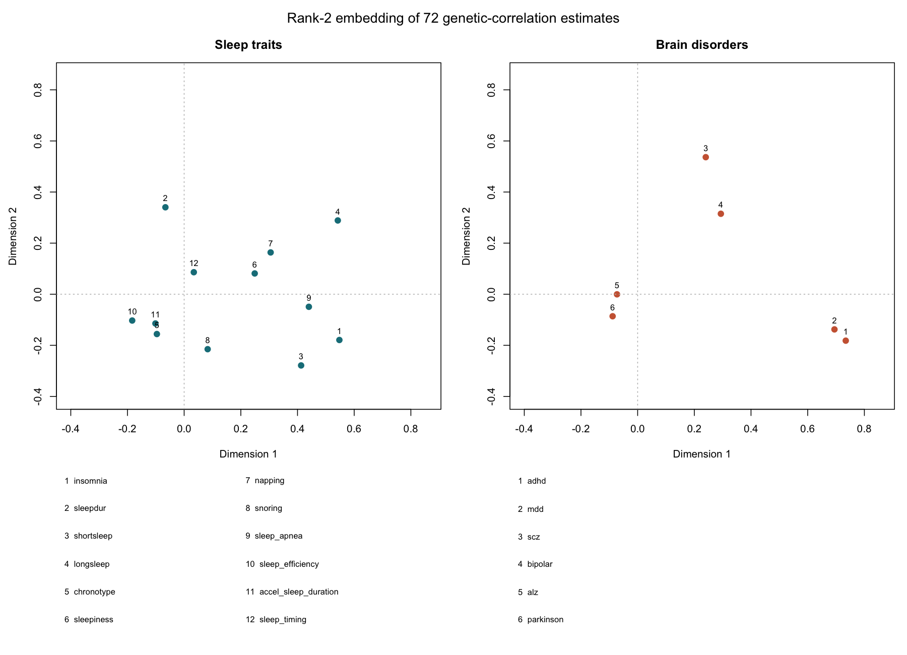

# Brain6 trait embedding: an initial genetics-based ML experiment

This experiment compresses the existing 12-sleep-trait by 6-brain-disorder matrix of genome-wide LDSC genetic correlations into two coordinates per trait. It uses the 72 reported correlations only. It does **not** use AlphaGenome predictions as training data, individual genomes, phenotype outcomes, or variant-by-variant interaction terms.

The two-dimensional singular-value decomposition approximates each sleep–disorder correlation by the dot product of the sleep and disorder coordinates. The two plotted axes are mathematical summaries whose signs and rotations are arbitrary; they are not established biological pathways. The components capture **96.0% of the matrix's squared numerical magnitude in-sample**. That is a reconstruction statistic, not the percentage of disease risk, genomic variance or phenotype variance explained. For example, the largest absolute rank-2 reconstruction residual was sleep timing versus Alzheimer disease: observed r_g=0.1083 (SE 0.0682), reconstructed −0.0025. The visual summary can therefore conceal or even reverse individual noisy relationships; use `reconstruction.tsv` and the original estimates rather than interpreting the plot alone.

To test whether the idea has any descriptive utility beyond fitting all 72 values, we repeatedly masked 20% of cells and estimated them from the remaining matrix. Over 10 repeated five-fold assignments, the pooled held-out root mean squared error was **0.1133** for a fixed two-component ridge matrix factorization versus **0.1442** for a simple mean of the observed values in the same disorder column. Two additional post-hoc comparators gave 0.1362 for an additive sleep-plus-disorder model and 0.1636 for a one-component ridge factorization; they were added after the first results were inspected. The 720 predictions reuse the same 72 estimates ten times and are strongly dependent. Sleep and disease GWAS share cohorts and signals, and test folds retain other entries from the same traits; this is *not* external validation, a confidence interval, a causal interaction test, a prediction of outcomes in individuals, or evidence of out-of-sample clinical performance. These are descriptive comparators, not a comprehensive benchmark; their post-hoc selection and the tiny, dependent dataset preclude a definitive model comparison. No hypothesis was corrected for using this embedding.

Coordinates near each other within the same panel have similar low-dimensional profiles in this particular factorization, subject to information loss and imprecise source estimates. A small plotted distance across the sleep and disorder panels does **not** itself equal a genetic correlation; the cross-panel dot product is the rank-2 reconstruction. Disease proximity is not a genetic correlation between the diseases. See the underlying table for exact matrix values and inherited 396-test FDR results. The ALS masked-cell factorization is fit separately from the full-matrix SVD shown in the plot; it uses one fixed initialization, ridge penalty 0.02 and 100 alternating updates. It is a small exploratory experiment, not a tuned, production-ready model. Assumptions and support differ across source GWAS, and covariance between estimated r_g values is not modeled.

## How to extend this idea

1. Confirm source overlap, phenotype coding and standard errors; fit a covariance-aware factorization using a shared block-jackknife covariance matrix if valid synchronized deletes can be obtained. Examine sensitivity to outliers and trait availability without declaring a new biological category.
2. Add FI, FFS and HFRS only after harmonizing comparable sleep–frailty correlations and recording ascertainment, reference and source differences. Test masked cells and completely held-out traits as descriptive robustness; use genuinely independent datasets for replication.
3. For variant-to-gene work, use fine-mapping and measured QTL/experimental labels first, and evaluate licensed genotype or functional annotations with chromosome/locus-held-out splits and conventional baselines. Incorporate AlphaGenome outputs only in ways permitted by its governing terms; this experiment did not train on those outputs. A sequence prediction may nominate an experiment, not establish the effect on both traits.
4. If individual-level data become available, build separate phenotype-specific PRS and evaluate associations and calibration in held-out people; test interaction terms only with appropriate phenotype and genotype data. A low-rank map of population correlations cannot generate a person's risk.

## Reproduce

`source_brain6_72.tsv` is the 72-row frozen Brain6 global table (SHA-256 recorded in `summary.json`), including all pair estimates and source metadata. Run `python embedding.py` in an environment with NumPy; the saved execution used Python 3.9.23 and NumPy 1.21.5. `Rscript plot.R coordinates.tsv trait_embedding.png` regenerates the base-R figure. The matrix completeness, uniqueness and finite SE checks are assertions in the script. `masked_cell_predictions.tsv` retains all 720 predictions for audit, while `summary.json` records the fixed split and model configuration.
